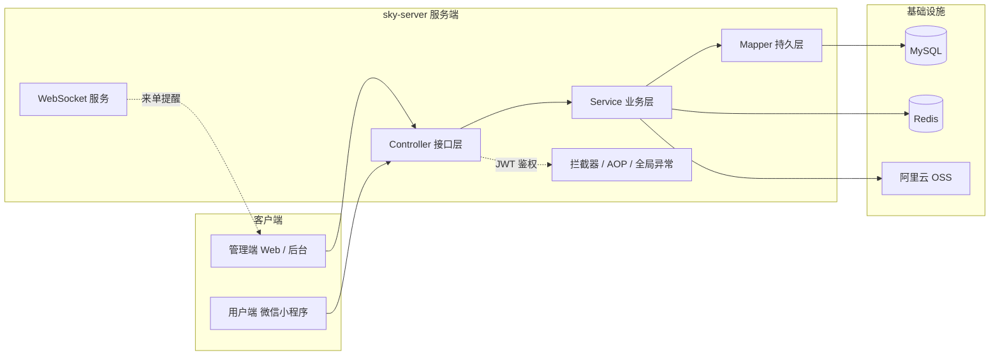

# 苍穹外卖 Sky Take-Out · 后端服务

<p>
  
  
  
  
  
  
  
</p>

> 一个面向餐饮企业的**一站式外卖点餐与配送管理**后端系统，覆盖管理端（商家 B 端）与用户端（顾客 C 端 / 微信小程序）的完整业务闭环：员工、分类、菜品、套餐、订单、营业状态、数据统计、来单提醒、微信登录与支付等。

> 📌 说明：本仓库为**教学初始工程**，采用 Maven 多模块结构，业务功能按课程进度逐步实现。文中版本号以根目录 `pom.xml` 与各子模块依赖的实际配置为准。

---

## 目录

- [项目简介](#项目简介)
- [功能特性](#功能特性)
- [技术栈](#技术栈)
- [系统架构](#系统架构)
- [模块说明](#模块说明)
- [目录结构](#目录结构)
- [快速开始](#快速开始)
- [配置文件说明](#配置文件说明)
- [接口文档](#接口文档)
- [核心设计亮点](#核心设计亮点)
- [部署](#部署)
- [常见问题](#常见问题)
- [开发规范](#开发规范)
- [路线图](#路线图)
- [贡献](#贡献)
- [许可证](#许可证)
- [致谢](#致谢)

---

## 项目简介

**苍穹外卖（Sky Take-Out）** 是一款典型的餐饮外卖业务系统，分为两个使用角色：

- **管理端（商家）**：员工管理、菜品 / 套餐维护、订单处理、营业状态、数据统计等。
- **用户端（顾客）**：微信登录、浏览菜品、购物车、下单、支付、查看订单状态等。

后端基于 **Spring Boot + MyBatis + MySQL + Redis** 构建，采用经典三层架构（Controller / Service / Mapper），并辅以 JWT 鉴权、AOP 公共字段自动填充、Redis 缓存、WebSocket 来单提醒等企业级实践，是学习 Java Web 全栈开发的完整范例。

---

## 功能特性

### 管理端（商家后台）

| 模块 | 说明 |
| --- | --- |
| 员工管理 | 员工登录、新增、分页查询、启用 / 禁用、编辑、修改密码 |
| 分类管理 | 菜品分类与套餐分类的增删改查、分页查询、启用 / 禁用 |
| 菜品管理 | 菜品新增（含口味与图片）、分页查询、起售 / 停售、编辑、批量删除 |
| 套餐管理 | 套餐新增（关联菜品）、分页查询、起售 / 停售、编辑、删除 |
| 店铺营业状态 | 设置和查询「营业中 / 打烊中」状态 |
| 订单管理 | 订单搜索、接单、拒单、取消、派送、完成等状态流转 |
| 数据统计 | 营业额、用户、订单、销量 Top10 等运营数据统计 |
| 工作台 | 今日数据概览、订单管理快捷入口 |
| 来单提醒 | 新订单 / 客户催单通过 WebSocket 实时提醒商家 |
| 文件上传 | 基于阿里云 OSS 的图片上传 |
| 数据导出 | 基于 Apache POI 的运营数据 Excel 导出 |

### 用户端（顾客 / 微信小程序）

| 模块 | 说明 |
| --- | --- |
| 微信登录 | 通过微信小程序授权完成静默登录，签发 JWT |
| 菜品浏览 | 按分类浏览菜品、套餐，查看菜品详情与口味 |
| 购物车 | 添加、减少、清空购物车 |
| 地址簿 | 收货地址的新增、修改、删除、查询 |
| 下单支付 | 提交订单、微信支付、订单状态查询 |
| 历史订单 | 查询历史订单、订单详情、取消订单、再来一单 |

> 具体已实现范围以当前分支代码为准；初始工程通常仅包含模块骨架、公共配置与基础接口。

---

## 技术栈

> 下表为该项目常用技术选型，**具体版本请以 `pom.xml` 实际依赖为准**。

| 分类 | 技术 | 说明 |
| --- | --- | --- |
| 语言 / 运行环境 | JDK 8+ | 推荐 JDK 11 运行 |
| 构建工具 | Maven 3.6+ | 多模块聚合构建 |
| 核心框架 | Spring Boot 2.7.x | 快速开发与自动装配 |
| Web 层 | Spring MVC | RESTful 接口 |
| 持久层 | MyBatis / MyBatis-Spring-Boot-Starter | SQL 映射，XML 与注解混用 |
| 分页 | PageHelper | 物理分页插件 |
| 数据库 | MySQL 8.0 | 业务数据存储 |
| 连接池 | Druid | 高性能数据库连接池 |
| 缓存 | Redis | 缓存、营业状态、验证码等场景 |
| 鉴权 | JWT (jjwt) + 拦截器 | 无状态登录鉴权 |
| 接口文档 | Knife4j (Swagger) | 在线调试与文档 |
| 对象存储 | 阿里云 OSS | 图片上传 |
| 消息推送 | WebSocket | 来单提醒、客户催单 |
| Excel 处理 | Apache POI | 运营数据导出 |
| 工具库 | Lombok / Fastjson | 简化开发 |
| 切面 | Spring AOP | 公共字段自动填充 |

---

## 系统架构



整体采用经典**分层架构**，请求自上而下经过「鉴权拦截 → 参数校验 → 业务处理 → 数据访问」，并通过 Redis、OSS、WebSocket 等中间件扩展能力。

---

## 模块说明

项目采用 Maven 多模块聚合结构，职责划分清晰：

| 模块 | 职责 |
| --- | --- |
| `sky-common` | 公共模块：统一返回结果、常量、枚举、异常、上下文、工具类、Jackson 配置等 |
| `sky-pojo` | 数据模型模块：`entity` 实体、`dto` 传输对象、`vo` 视图对象 |
| `sky-server` | 服务端模块：启动类、Controller、Service、Mapper、配置、拦截器、定时任务、WebSocket 等 |

---

## 目录结构

```text
sky-take-out
├── pom.xml                      # 父工程 POM，统一依赖与版本管理
├── sky-common                   # 公共模块
│   └── src/main/java/com/sky
│       ├── constant             # 常量
│       ├── context              # 线程上下文（如当前登录用户）
│       ├── enumeration          # 枚举
│       ├── exception            # 自定义异常
│       ├── json                 # Jackson 序列化配置
│       ├── properties           # 配置属性类
│       ├── result               # 统一响应 Result / PageResult
│       └── utils                # 工具类（JWT、OSS 等）
├── sky-pojo                     # 数据模型模块
│   └── src/main/java/com/sky
│       ├── dto                  # 请求传输对象
│       ├── entity               # 数据库实体
│       └── vo                   # 返回视图对象
└── sky-server                   # 服务端模块
    └── src/main
        ├── java/com/sky
        │   ├── SkyApplication.java   # 启动类
        │   ├── config                # Web / Knife4j / Redis 等配置
        │   ├── controller            # 管理端与用户端接口
        │   ├── handler               # 全局异常处理
        │   ├── interceptor           # JWT 鉴权拦截器
        │   ├── mapper                # MyBatis Mapper 接口
        │   ├── service               # 业务接口与实现
        │   ├── task                  # 定时任务
        │   └── websocket             # WebSocket 服务端
        └── resources
            ├── application.yml       # 主配置
            ├── application-dev.yml   # 开发环境配置
            └── mapper                # MyBatis XML 映射文件
```

> 目录为通用结构示意，实际文件以仓库为准。

---

## 快速开始

### 1. 环境要求

| 环境 | 版本要求 |
| --- | --- |
| JDK | 8 及以上（推荐 11） |
| Maven | 3.6+ |
| MySQL | 8.0+ |
| Redis | 5.0+（推荐 6.x） |
| IDE | IntelliJ IDEA（推荐） |

### 2. 准备数据库

1. 创建数据库，例如 `sky_take_out`。
2. 导入项目提供的 SQL 脚本（通常位于课程资料 `sql` 目录），完成建表与初始化数据。
3. 确认字符集为 `utf8mb4`。

### 3. 修改配置

编辑 `sky-server/src/main/resources/application-dev.yml`（或 `application.yml`），将数据源、Redis 等改为本地环境：

```yaml
sky:
  datasource:
    driver-class-name: com.mysql.cj.jdbc.Driver
    host: localhost
    port: 3306
    database: sky_take_out
    username: root
    password: your_password

  redis:
    host: localhost
    port: 6379
    password: ""
    database: 0
```

> 如使用阿里云 OSS、微信支付、微信登录等功能，还需在配置中填写对应 `access-key`、`appid`、`secret`、`mchid` 等参数。

### 4. 启动项目

在项目根目录执行：

```bash
mvn clean install -DskipTests
cd sky-server
mvn spring-boot:run
```

或直接在 IDEA 中运行 `sky-server` 模块下的 `SkyApplication` 启动类。

启动成功后默认访问端口为 `8080`（以配置为准），此时可打开接口文档验证。

---

## 配置文件说明

`application.yml` / `application-dev.yml` 中常用的核心配置项：

| 配置项 | 说明 |
| --- | --- |
| `sky.datasource.*` | 数据库连接（驱动、地址、库名、账号密码） |
| `sky.redis.*` | Redis 连接信息 |
| `sky.jwt.admin-secret-key` | 管理端 JWT 签名密钥 |
| `sky.jwt.admin-ttl` | 管理端 Token 有效期 |
| `sky.jwt.user-secret-key` | 用户端 JWT 签名密钥 |
| `sky.jwt.user-ttl` | 用户端 Token 有效期 |
| `sky.alioss.*` | 阿里云 OSS 对象存储配置 |
| `sky.wechat.*` | 微信登录 / 支付相关配置 |
| `sky.shop.address` | 店铺地址（用于配送范围计算等） |

> 敏感信息（密钥、密码）建议通过环境变量或 `application-local.yml` 注入，避免提交到版本库。

---

## 接口文档

项目集成 **Knife4j** 在线接口文档，启动后访问：

```text
http://localhost:8080/doc.html
```

可在页面上浏览分组接口、查看参数说明并直接在线调试。

---

## 核心设计亮点

- **统一响应结构**：通过 `Result<T>` 与 `PageResult<T>` 统一接口返回格式，配合全局异常处理器输出一致的错误信息。
- **JWT 无状态鉴权**：管理端与用户端分别使用独立密钥与有效期，通过拦截器统一校验并解析当前登录用户。
- **AOP 公共字段自动填充**：借助自定义注解与切面，自动填充 `createTime`、`updateTime`、`createUser`、`updateUser` 等字段。
- **Redis 应用**：用于店铺营业状态、验证码、热点数据缓存等场景，降低数据库压力。
- **WebSocket 实时提醒**：新订单、客户催单实时推送到商家端，提升接单效率。
- **阿里云 OSS**：图片统一上传对象存储，返回可访问 URL。
- **订单状态机**：订单状态流转（待接单 → 已接单 → 派送中 → 已完成 / 已取消）清晰可控。
- **定时任务**：处理超时未支付订单自动取消等业务。

---

## 部署

### 打包运行

```bash
mvn clean package -DskipTests
java -jar sky-server/target/sky-server-*.jar --spring.profiles.active=prod
```

### 反向代理（可选）

生产环境可使用 Nginx 作为反向代理与静态资源服务器，将 `/api` 请求转发至后端服务，并托管管理端页面。

---

## 常见问题

**Q1：启动报数据库连接失败？**
检查 MySQL 是否启动、`application-dev.yml` 中的地址 / 端口 / 库名 / 账号密码是否正确，以及数据库是否已导入。

**Q2：访问接口提示 401 / 未登录？**
管理端与用户端请求需携带对应 Token（请求头字段以拦截器实现为准），并确认 JWT 密钥与有效期配置正确。

**Q3：图片上传失败？**
检查阿里云 OSS 的 `endpoint`、`bucket-name`、`access-key-id`、`access-key-secret` 是否有效，以及桶的读写权限。

**Q4：WebSocket 无法收到来单提醒？**
确认已建立 WebSocket 连接、`clientId` 与商家账号绑定正确，并检查后端 WebSocket 服务及端口是否可达。

**Q5：中文乱码 / 时间格式不对？**
确认数据库字符集为 `utf8mb4`，并在全局 Jackson 配置中统一时区与日期格式。

---

## 开发规范

- 遵循 RESTful 风格设计接口，统一使用 `Result` 返回。
- Controller 只做参数接收与结果返回，业务逻辑放在 Service。
- 实体、DTO、VO 分层清晰，避免直接暴露数据库实体。
- 提交前执行 `mvn clean package` 确保可编译、测试通过。
- 敏感配置不入库，使用 profile 或环境变量隔离。

---

## 路线图

- [x] 项目骨架与多模块搭建
- [x] 公共模块与统一返回、异常处理
- [ ] 员工管理与登录鉴权
- [ ] 分类 / 菜品 / 套餐管理
- [ ] 店铺营业状态与缓存
- [ ] 用户端微信登录与浏览下单
- [ ] 订单流转、微信支付
- [ ] 数据统计与 Excel 导出
- [ ] WebSocket 来单提醒与催单
- [ ] 部署与性能优化

> 路线图对应课程进度，勾选状态请按实际实现情况调整。

---

## 贡献

欢迎通过 Issue 反馈问题或提交 Pull Request 改进项目。提交前请确保：

1. Fork 本仓库并基于 `main` 新建分支；
2. 保持代码风格一致，补充必要注释；
3. 描述清楚改动内容与验证方式。

---

## 许可证

本项目基于 [MIT License](LICENSE) 开源，仅供学习交流使用。

---

## 致谢

- 感谢开源社区提供的 Spring Boot、MyBatis、Redis、Knife4j 等优秀框架与工具。
- 本项目作为 Java Web 全栈学习实践，参考了常见的餐饮外卖业务设计思路。

如果这个项目对你有帮助，欢迎点一个 Star 支持一下。
